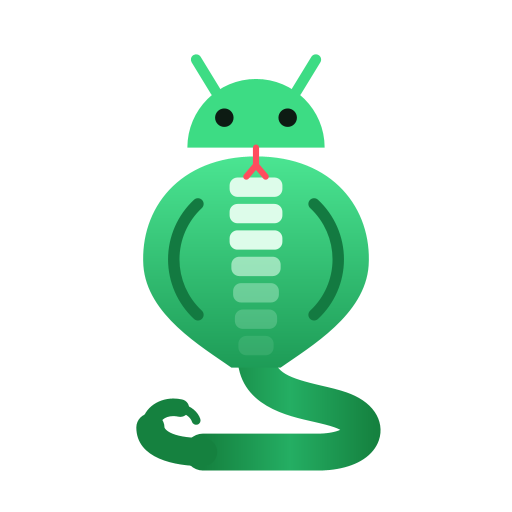

<p align="center"></p>

<h1 align="center">CovRA — Coverage Results Analyzer</h1>

<p align="center">Live Android code coverage for manual testing, built on <a href="https://github.com/JordanSamhi/AndroLog">AndroLog</a>.</p>

CovRA is a live Android code coverage analyzer designed to support manual testing by streamlining testers' workflows and helping them focus on unexplored and uncovered parts of the application under test.

CovRA shows which **statements, methods, classes, activities, services, broadcast receivers and content providers** have been executed, and which have not. CovRA is available as a **standalone** and as an **Android Studio plugin**.

This repository distributes the CovRA binaries, a sample instrumented app and a sample coverage log. The source code is not included.

## Features

- **Live dashboard**: coverage per metric, coverage over time, a live feed of newly covered code and a
  checklist of the screens still to explore.
- **Coverage explorers**: search, filter and sort every statement, method, class and component.
- **Decompiled sources with coverage overlay** (optional, with JADX): read the Java code of any class, with
  method declarations marked as covered, not covered or partially covered.
- **Window transition graph**: the app's screens and the transitions between them, computed statically from the
  APK, with visited screens highlighted.
- **Session memory**: previous sessions are listed on the start screen and resumed in one click.

## Requirements

| | Standalone | Plugin |
|---|---|---|
| Runtime | Java 17 or newer | Android Studio 2025.2 or newer |
| Android SDK `platforms` folder | Required | Required (pre-filled from the IDE's SDK) |
| [JADX](https://github.com/skylot/jadx) | Optional, for decompiled sources | Optional, for decompiled sources |

**Android platforms.** CovRA's static analysis needs the `platforms` folder of an Android SDK, with at least
one platform installed. If you have no SDK, install the [Android command-line tools](https://developer.android.com/studio#command-line-tools-only) and run `sdkmanager "platforms;android-34"`.

**JADX** is only needed to browse decompiled sources. If it isn't installed, turn off *Decompile with JADX*.
To install it, run `brew install jadx` on macOS, or download a release from the JADX repository.

## Quick start: try CovRA without a device

This walkthrough uses the samples in this repository, so no emulator or phone is needed.

1. Start CovRA:
   ```bash
   java -jar artifacts/covra-1.0.0.jar
   ```
2. In the session setup window, fill in:

   | Field | Value |
   |---|---|
   | Instrumented APK | `samples/DummyApp.apk` |
   | Log source | *Log file* → `samples/DummyApp-logs.txt` |
   | Log identifier | `ANDROLOG` |
   | Android platforms | your SDK `platforms` folder (see [Requirements](#requirements)) |
   | Decompile with JADX | on if JADX is installed, otherwise off |

3. Click **Start session**.

## Live testing with a device or emulator

**Use.**
1. Install the instrumented app: `adb install samples/DummyApp.apk`.
2. Start CovRA and fill in the session setup as above, but choose **Capture with adb** as the log source.
3. Use the app on the device. CovRA picks up each new log line within a fraction of a second.

If you prefer to capture the log yourself, choose *Log file* and run:

```bash
adb logcat -s ANDROLOG > logs.txt
```

## Android Studio plugin

**Install.** In Android Studio: **Settings → Plugins → ⚙ → Install Plugin from Disk…**, select
`artifacts/covra-android-studio-plugin-1.0.0.zip` and restart the IDE.

**Use.**
1. Open the **CovRA** tool window from the right-hand tool bar, or with **Tools → CovRA: Live Coverage**.
2. Fill in the session setup (same fields as the standalone) and click **Start session**.
3. Test the app. Decompiled sources open in the IDE editor, with the coverage overlay.

## Using CovRA on your own app

CovRA works on any APK instrumented with [AndroLog](https://github.com/JordanSamhi/AndroLog). Instrument the app
with the granularities you want to measure, then install the instrumented APK and use it as CovRA's input.

CovRA always analyses the **instrumented** APK; the original APK is not needed. When the APK contains no AndroLog
probes, or was instrumented with a different log identifier, CovRA warns you when the session starts.

## Data

CovRA keeps its settings, recent sessions, analysis cache and captured logs in `~/.covra`
(`%USERPROFILE%\.covra` on Windows). Delete `~/.covra/cache` to discard cached analyses.

## Related projects

- [AndroLog](https://github.com/JordanSamhi/AndroLog): the APK instrumentation tool CovRA builds on.
- [JADX](https://github.com/skylot/jadx): the Dex-to-Java decompiler used for source browsing.
