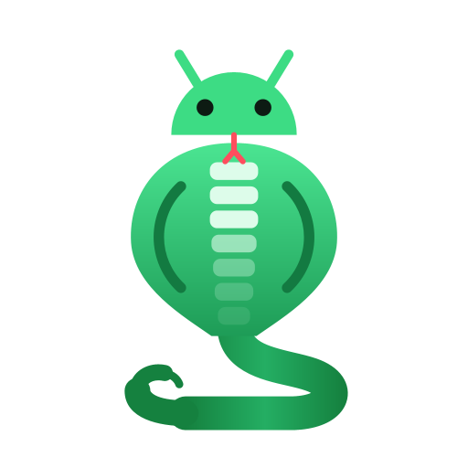

<p align="center"></p>

<h1 align="center">CovRA — Coverage Results Analyzer</h1>

<p align="center">Live Android code coverage for manual testing, built on <a href="https://github.com/JordanSamhi/AndroLog">AndroLog</a>.</p>

CovRA is a live Android code coverage analyzer designed to support manual testing by streamlining testers'
workflows and helping them focus on unexplored and uncovered parts of the application under test.

## Requirements

| | Standalone | Plugin |
|---|---|---|
| Runtime | Java 17 or newer | Android Studio 2025.2 or newer |
| Android SDK `platforms` folder | Required | Required (pre-filled from the IDE's SDK) |
| [JADX](https://github.com/skylot/jadx) | Optional, for decompiled sources | Optional, for decompiled sources |

## Quick start:

1. Start CovRA:
   ```bash
   java -jar artifacts/covra-1.0.0.jar
   ```
2. In the session setup window, fill in:

   | Field | Value |
   |---|---|
   | Instrumented APK | `samples/DummyApp.apk` |
   | Log source | *Log file* → `samples/DummyApp-logs.txt` |
   | Log identifier | `ANDROLOG` |
   | Android platforms | your SDK `platforms` folder (see [Requirements](#requirements)) |
   | Include library code | either (DummyApp has no third-party libraries) |
   | Decompile with JADX | on if JADX is installed, otherwise off |

3. Click **Start session**. The first analysis of an APK takes a few seconds; after that it is cached.
4. Explore the dashboard, the coverage explorers, the decompiled sources and the window transition graph.